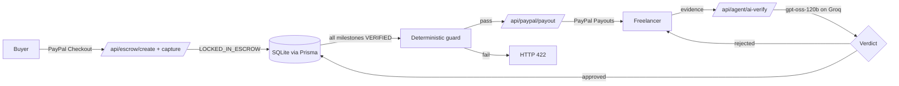

# AutoSovereign

**Escrow that pays itself: PayPal holds the money, an AI agent decides when the work is earned.**

Built for the [PayPal AI Hackathon: Build What's Next with PayPal and AI](https://paypal-ai-hackathon.devpost.com/). Everything runs in the **PayPal sandbox**; no real money moves.

> Demo video: _add your YouTube link here_

---

## The problem

Freelancers get ghosted after delivering. Clients pay up front and get nothing. Traditional escrow still needs a human to decide whether the work is done, which is slow, biased and expensive.

## What AutoSovereign does

1. A contract is split into **milestones**, each with a deliverable description.
2. The buyer **funds the full amount through PayPal Checkout**. The contract moves to `LOCKED_IN_ESCROW` and every milestone to `FUNDED`.
3. The freelancer submits **evidence** for a milestone.
4. An **AI verification agent** compares the evidence to the milestone and returns `approved`, a `confidence` score and `reasons`. Vague evidence is rejected.
5. Only when **every milestone is `VERIFIED`** can the payout be released, through the **PayPal Payouts API**. The freelancer receives the amount minus a 5% platform fee.
6. If the buyer needs their money back before payout, the escrow can be **refunded** through the PayPal captures refund API.

## How PayPal is used

| PayPal capability | Where | What it does |
| --- | --- | --- |
| Orders v2 (`/v2/checkout/orders`) | `src/app/api/escrow/create` | Creates a CAPTURE order for the contract total |
| Orders capture | `src/app/api/escrow/capture` | Captures the buyer's payment and flips the contract to `LOCKED_IN_ESCROW` |
| PayPal JS SDK buttons | `src/components/BuyerCheckout.tsx` | Buyer approves payment in the PayPal popup (`@paypal/react-paypal-js`) |
| Payouts (`/v1/payments/payouts`) | `src/app/api/paypal/payout` | Sends the freelancer's share and stores the real `payout_batch_id` |
| Captures refund | `src/app/api/escrow/refund` | Returns the escrowed money to the buyer |
| Webhook signature verification | `src/app/api/webhooks/paypal` | Verifies events through `/v1/notifications/verify-webhook-signature` and de-duplicates them |
| Idempotency (`PayPal-Request-Id`) | `src/lib/paypal.ts` | Retried requests cannot double-charge or double-pay |
| Sandbox mock response | `capture` + "Simulate card decline" checkbox | Demonstrates a declined payment using `PayPal-Mock-Response` |

## How AI is used

- **Model:** `openai/gpt-oss-120b` served on **Groq**, called through the **Vercel AI SDK** (`ai` + `@ai-sdk/openai` pointed at Groq's OpenAI-compatible endpoint). See `src/lib/ai-judge.ts`.
- **Structured verdict:** the model must return JSON that is validated with **Zod** (`approved`, `confidence` 0 to 1, up to 5 `reasons`).
- **Strict by design:** temperature 0; a verdict with `confidence < 0.7` is forced to `approved = false`; the prompt tells the model to ignore any instructions inside the evidence (prompt-injection resistance); the model **never sees payment amounts**.
- **Auditable:** every verdict is written to the `AgentLog` table with its reasoning.

## Guardrail: AI never moves money directly

The AI only changes a milestone's status. Releasing money is a separate server-side step guarded by deterministic code (`src/lib/escrowGuard.ts`):

- all milestones must be `VERIFIED`
- the escrow must be `COMPLETED` (payment captured)
- the payout amount must be valid and the contract must not be disputed

If any check fails, `POST /api/paypal/payout` returns **HTTP 422** and nothing is sent. A payout can also only happen once per contract (batch id is stored and re-used).

## Architecture



## Tech stack

Next.js 16 (App Router), React 19, TypeScript, Tailwind CSS, Prisma + SQLite, PayPal REST API (sandbox), Vercel AI SDK, Groq (`gpt-oss-120b`), Zod.

---

## Run it locally

### Prerequisites

- Node.js 20.9 or newer
- A free [PayPal Developer](https://developer.paypal.com/) account
- A free [Groq](https://console.groq.com/) API key

### 1. PayPal sandbox setup (about 5 minutes)

1. In the PayPal Developer Dashboard, open **Apps & Credentials**, make sure **Sandbox** is selected, and create an app. Copy its **Client ID** and **Secret**.
2. Open **Testing tools, then Sandbox accounts**. You need two **Personal** accounts:
   - a **buyer** (you log in with this on the checkout page)
   - a **freelancer / seller** (receives the payout). Its email goes in `SELLER_PAYPAL_EMAIL`.
3. Optional: add a webhook for `http://<public-url>/api/webhooks/paypal` and copy its **Webhook ID** into `PAYPAL_WEBHOOK_ID`. The demo flow works without it.

### 2. Install and configure

```bash
git clone https://github.com/Binaya-fdp77/autosovereign.git
cd autosovereign
npm install
cp .env.example .env        # on Windows PowerShell: Copy-Item .env.example .env
```

Fill in `.env`:

| Variable | Required | Description |
| --- | --- | --- |
| `DATABASE_URL` | yes | Leave as `file:./dev.db` (SQLite) |
| `PAYPAL_API_BASE` | yes | `https://api-m.sandbox.paypal.com` |
| `PAYPAL_CLIENT_ID` | yes | Sandbox app client ID (server) |
| `NEXT_PUBLIC_PAYPAL_CLIENT_ID` | yes | The same client ID (used by the browser buttons) |
| `PAYPAL_CLIENT_SECRET` | yes | Sandbox app secret |
| `GROQ_API_KEY` | yes | Powers the AI verification agent |
| `SELLER_PAYPAL_EMAIL` | yes | Sandbox **Personal** account email that receives payouts |
| `PAYPAL_WEBHOOK_ID` | no | Only needed to test webhook verification |

### 3. Create and seed the database

```bash
npx prisma db push
node prisma/seed.js
```

This creates one demo contract, **"Landing page build" ($100)**, with three milestones: *Responsive layout delivered* ($40), *Contact form working* ($30), *Deployed and handed over* ($30).

### 4. Start the app

```bash
npm run dev
```

Open <http://localhost:3000> (it redirects to `/dashboard`).

To reset to a clean demo at any time: `npx prisma db push --force-reset` then `node prisma/seed.js`.

---

## Try the full flow (about 3 minutes)

### In the browser

1. Open <http://localhost:3000/pay> in a private window. Leave **Simulate card decline** unticked, click the **PayPal** button, log in with your sandbox **buyer**, and approve. You will see **Escrow funded**.
2. Open <http://localhost:3000/dashboard>. The contract shows `LOCKED_IN_ESCROW` and its milestones are `FUNDED`.
3. Click **Release payout** now. It is blocked (HTTP 422) because nothing is verified yet.
4. For a milestone, submit vague evidence such as `I finished it, looks good.` The AI **rejects** it and explains what is missing.
5. Submit real evidence, for example:
   - Layout: `Deployed at https://demo.example.com. index.html contains header, hero, 3-card features grid and footer. CSS uses flex/grid with @media (max-width:768px) breakpoints; screenshots at 375px and 1440px attached and show no overflow.`
   - Contact form: `Contact form validates name, email format and message length client-side and server-side. POST /api/contact returns 200 with JSON {ok:true}; invalid input returns 400 with field errors. Test log: 6 of 6 cases pass.`
   - Deployment: `Site live at https://demo.example.com (HTTP 200). Repo github.com/bob/landing transferred to alice-buyer; transfer accepted, confirmation email attached.`
6. When all three milestones are `VERIFIED`, click **Release payout**. The response contains a real **PayPal payout batch id**, and the seller's sandbox balance at <https://www.sandbox.paypal.com> increases by **$95.00** ($100 minus the 5% fee).

### With the API (PowerShell)

```powershell
function P($u,$o){ try { $r = Invoke-WebRequest "http://localhost:3000$u" -Method Post -ContentType 'application/json' -Body ($o|ConvertTo-Json -Depth 5) -UseBasicParsing; "$($r.StatusCode) $($r.Content)" } catch { $resp=$_.Exception.Response; $sr=New-Object IO.StreamReader($resp.GetResponseStream()); "$([int]$resp.StatusCode) $($sr.ReadToEnd())" } }
$k = (Invoke-RestMethod http://localhost:3000/api/contracts).contracts[0]
$c = $k.id; $m1 = $k.milestones[0].id

P '/api/paypal/payout' @{contractId=$c}                                              # 422: nothing verified
P '/api/agent/ai-verify' @{contractId=$c; milestoneId=$m1; evidence='looks good'}    # approved: false
```

---

## API reference

| Method and path | Body | Purpose |
| --- | --- | --- |
| `GET /api/contracts` | | Contracts with milestones, buyer and seller |
| `POST /api/escrow/create` | `{ contractId }` | Create the PayPal order for the contract |
| `POST /api/escrow/capture` | `{ contractId, simulate? }` | Capture payment; `simulate: "decline"` triggers a sandbox decline |
| `POST /api/agent/ai-verify` | `{ contractId, milestoneId, evidence }` | AI verdict; sets the milestone to `VERIFIED` or leaves it `SUBMITTED` |
| `POST /api/paypal/payout` | `{ contractId }` | Release the payout (422 unless every milestone is verified) |
| `POST /api/escrow/refund` | `{ contractId }` | Refund the buyer (only before payout) |
| `POST /api/webhooks/paypal` | PayPal event | Verified, de-duplicated webhook receiver |
| `GET /api/health` | | Database and PayPal configuration status |

The repository also contains additional experimental agent endpoints under `src/app/api/agent/` (negotiation, mediation, auditing and more). They are not part of the demonstrated flow above.

## Data model

Prisma models: `User`, `Contract`, `Milestone`, `EscrowState` (PayPal order, capture and payout batch ids, fee split), `AgentLog` (every AI verdict with reasoning) and `IdempotencyKey`. See `prisma/schema.prisma`.

## Deploying (optional)

`render.yaml` is included for deploying to [Render](https://render.com). Set the secret variables listed above in the Render dashboard (`NEXT_PUBLIC_PAYPAL_CLIENT_ID` must be present at build time). The start command pushes the schema and seeds the demo contract. SQLite on Render's free plan is ephemeral, which is fine for a demo.

## Limitations

- Sandbox only. Production use would need real PayPal credentials, user authentication and per-user contracts.
- Contract creation and negotiation are not exposed in the UI; the demo uses a seeded contract.
- The AI judge is a single model call. A production system would add human dispute resolution for contested verdicts.

## License

[MIT](./LICENSE)